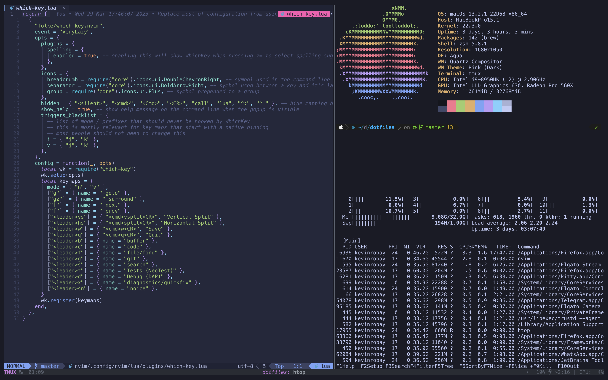

# dotfiles

Personal macOS dotfiles managed with [GNU Stow](https://www.gnu.org/software/stow/) and [mise](https://mise.jdx.dev). Configs for Neovim, zsh, tmux, git, and more, plus opinionated macOS defaults. mise installs the language runtimes and CLI tools; Homebrew covers only what mise can't (zsh, tmux, services, libraries, casks and fonts).



## Bootstrapping a new laptop

1. Install the Xcode command line tools (for `git`) and [Homebrew](https://brew.sh):

   ```bash
   xcode-select --install
   /bin/bash -c "$(curl -fsSL https://raw.githubusercontent.com/Homebrew/install/HEAD/install.sh)"
   eval "$(/opt/homebrew/bin/brew shellenv)"
   ```

2. Install mise and log in to GitHub with the `gh` it provides. mise uses the
   token for GitHub API calls; anonymously it runs out of rate limit partway
   through the install:

   ```bash
   brew install mise
   mise exec gh -- gh auth login
   ```

   On a network that blocks Sigstore (`*.sigstore.dev`), mise can't verify
   release provenance and every install fails with `TUF repository load
   failed`. On such a machine, export these first (and keep them in the
   untracked `~/.zshrc.work`); SHA256 checksums still run:

   ```bash
   export MISE_GITHUB_ATTESTATIONS=false MISE_SLSA=false \
     MISE_AQUA_GITHUB_ATTESTATIONS=false MISE_AQUA_COSIGN=false MISE_AQUA_SLSA=false \
     MISE_GITHUB_GITHUB_ATTESTATIONS=false MISE_GITHUB_SLSA=false
   ```

3. Clone the repo and run the bootstrap task:

   ```bash
   git clone https://github.com/kevinrobayna/dotfiles ~/personal/dotfiles
   cd ~/personal/dotfiles
   touch ~/.secrets          # KEY=value env vars the shell exports; never committed
   mise run bootstrap
   ```

   It asks for your password a few times (`/etc/shells`, `chsh`, `tlmgr`), and
   it is safe to re-run.

4. Open a new terminal, start tmux, and press `prefix + I` to install the tmux plugins.

## Tasks

Every setup step is a [mise file task](https://mise.jdx.dev/tasks/file-tasks.html) in `mise-tasks/`. Run `mise tasks` to list them, or run any one on its own:

```bash
mise run bootstrap   # Everything below, in order
mise run homebrew    # Install Homebrew packages from the Brewfile
mise run link        # Symlink configs into $HOME (via stow)
mise run shell       # Set Homebrew zsh as the default shell
mise run macos       # Apply macOS system defaults
mise run tools       # Install runtimes and CLI tools from the mise config
mise run extras      # nvim python/perl providers, LaTeX packages
mise run tmux        # Install the tmux plugin manager
mise run docker      # Docker CLI: Homebrew plugins (buildx), Keychain logins
mise run update      # Upgrade Homebrew packages and mise tools
```

To add a CLI tool, add it to `config/.config/mise/config.toml` (not the Brewfile) and run `mise install`.

## What's Inside

**Shell** — zsh with [starship](https://starship.rs) prompt, [zoxide](https://github.com/ajeetdsouza/zoxide) smart cd, [fzf](https://github.com/junegunn/fzf) fuzzy finder, [eza](https://github.com/eza-community/eza) ls replacement, and custom aliases

**Editor** — [Neovim](https://neovim.io) with [LazyVim](https://www.lazyvim.org) framework, language servers, treesitter, formatters, and git integration

**Terminal** — [Ghostty](https://ghostty.org) and [tmux](https://github.com/tmux/tmux) with custom keybindings and status line

**Git** — [delta](https://github.com/dandavison/delta) for diffs, [lazygit](https://github.com/jesseduffield/lazygit) TUI, GPG commit signing, custom hooks

**macOS** — [Hammerspoon](https://www.hammerspoon.org) hotkeys, Finder tweaks, keyboard repeat speed, Dock settings, and 30+ system defaults

**Dev Tools** — Docker via [Colima](https://github.com/abiosoft/colima), [mise](https://mise.jdx.dev) for language runtimes and CLI tools, AWS CLI, GCloud CLI, [k9s](https://k9scli.io)

## Custom Scripts

Scripts in `bin/` are added to `$PATH`:

| Script | Description |
|--------|-------------|
| `gwt` | Create a git worktree with interactive branch selection, opens in tmux |
| `gwt-rm` | Remove git worktrees and their associated tmux sessions |
| `gh-review` | List GitHub PRs requesting your review (direct + team) |
| `gh-reviewers` | Interactively add reviewers to a GitHub PR |
| `tmux-sessionizer` | Fuzzy-pick a project and open/attach a tmux session |

## Architecture

Configs are symlinked into `$HOME` using GNU Stow with three packages:

```
config/          -> $HOME          (contains .config/ subtree: nvim, zsh, tmux, git, etc.)
gitconfig/       -> $HOME          (--dotfiles flag: dot-gitconfig becomes .gitconfig)
claude/          -> $HOME          (--dotfiles flag: dot-claude/ becomes .claude/)
```

Manual symlinks for apps that use `~/Library/Application Support/`:

```
lazygit/config.yml    -> ~/Library/Application Support/jesseduffield/lazygit/config.yml
lazydocker/config.yml -> ~/Library/Application Support/jesseduffield/lazydocker/config.yml
ghostty/config        -> ~/Library/Application Support/com.mitchellh.ghostty/config
```

## Requirements

- macOS
- [Homebrew](https://brew.sh) and [mise](https://mise.jdx.dev) (see [Bootstrapping a new laptop](#bootstrapping-a-new-laptop))
